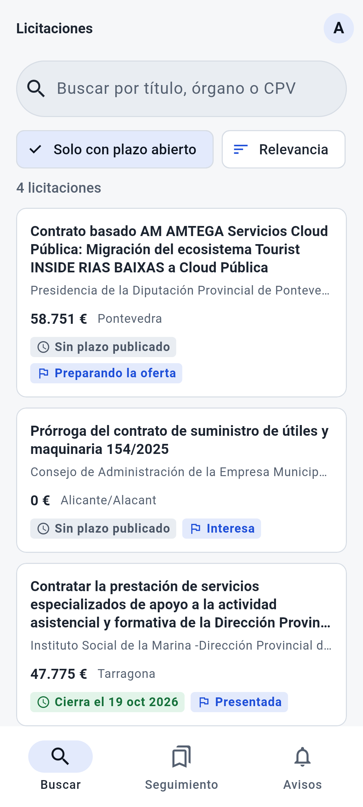
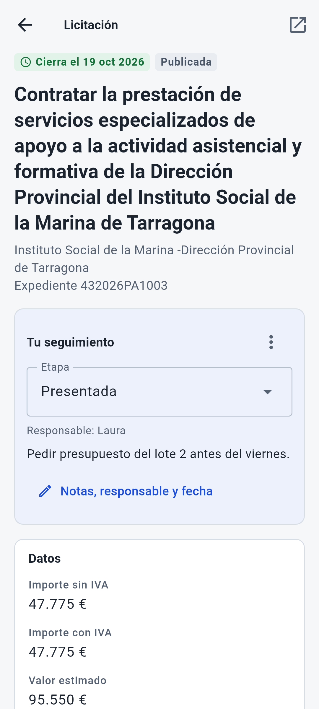
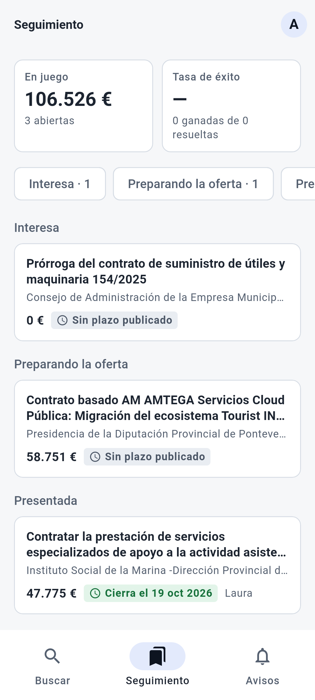
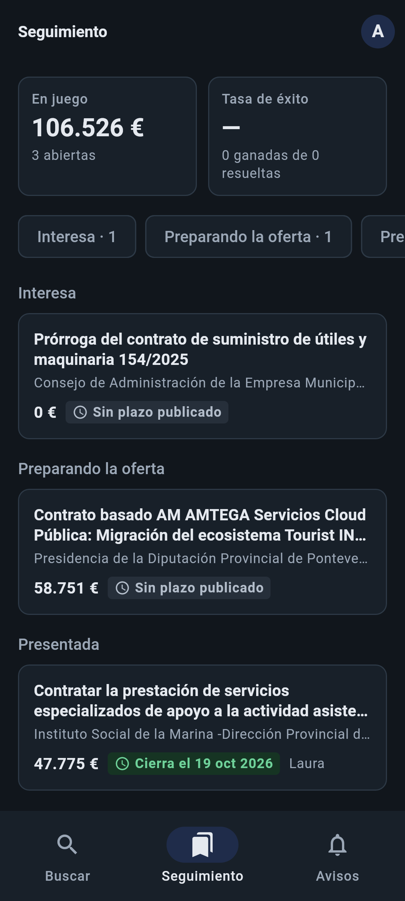

# Radar móvil

App de **Android** para las empresas que se presentan a licitaciones públicas: busca en el
[radar de licitaciones](https://github.com/marnau74/radar-licitaciones), sigue las que te interesan y llévalas por
tu propio embudo de ofertas (*Interesa → Preparando → Presentada → Ganada / Perdida / Descartada*), con notas,
responsable, fecha límite interna y avisos antes de que cierre el plazo. Funciona sin conexión.

**Flutter · Dart en el servidor · MongoDB · Riverpod · go_router · drift · Keycloak (OIDC + PKCE)**

| Búsqueda | Ficha y seguimiento | Embudo | Embudo en oscuro |
|---|---|---|---|
|  |  |  |  |

Las licitaciones de las capturas son reales (la muestra del feed de la Plataforma de Contratación que trae el
radar); las etapas, la responsable y la nota son de ejemplo. Las pantallas se pintan desde una prueba con las
fuentes de verdad (ver [Capturas](#capturas)).

## Qué hace

- **Buscar** licitaciones en la API pública del radar (texto, solo con plazo abierto, cuatro órdenes) con paginación
  al bajar, y ver su **ficha**: importes, plazo, órgano, CPV, lotes, adjudicación y pliegos.
- **Seguir** una licitación con la misma cuenta de Keycloak que la web del radar. El seguimiento se guarda en su
  servidor (`servidor/`, Dart + MongoDB) y se comparte entre dispositivos.
- **Embudo**: cuántas hay en cada etapa, importe en juego de las abiertas y tasa de éxito (ganadas entre resueltas).
  El cambio de etapa es un menú, no un tablero que se arrastra: en el móvil se usa mejor y es accesible.
- **Sin conexión**: todo se lee y se escribe en una base local (SQLite con drift) y los cambios se suben al volver la
  red. Si el mismo seguimiento se ha cambiado en otro dispositivo, **no se pisa**: la app enseña las dos versiones y
  deja elegir.
- **Avisos** sin Firebase: 72 y 24 horas antes del cierre del plazo y el día de la fecha interna, programados en el
  móvil; y un aviso cuando las alertas que tienes en el radar encuentran licitaciones nuevas (tarea periódica con
  WorkManager). El permiso se pide al seguir la primera licitación, no al arrancar.
- Tema claro y oscuro con los colores de la web del radar, cifras tabulares, textos del sistema respetados y
  etiquetas de accesibilidad en importes y plazos.

## Arquitectura

```
app/lib/src/
├── modelos/      Licitación, ficha, seguimiento, embudo (freezed + json_serializable)
├── red/          dio: APIs del radar y del servidor, token y reintento tras 401, errores RFC 9457
├── sesion/       Sesión de Keycloak: AppAuth (código + PKCE), tokens cifrados, refresco único
├── datos/        drift: copia local de los seguimientos y cola de cambios; sincronización y conflictos
├── avisos/       Cuándo avisar (lógica pura) y notificaciones locales
├── estado.dart   Providers de Riverpod 3 (generados)
├── rutas.dart    go_router con rutas tipadas: tres secciones con su pila y la ficha por encima
├── servicios.dart  Todo montado a mano: lo usan la interfaz y la tarea en segundo plano
└── ui/           Pantallas y componentes Material 3

servidor/lib/src/
├── dominio.dart       Etapas, validación de los cambios (todos los errores a la vez), embudo
├── repositorio.dart   MongoDB: índices, concurrencia optimista con `version`, agregación del embudo
├── autenticacion.dart Verificación de los JWT de Keycloak con su JWKS (en caché, con rotación de claves)
└── api.dart           shelf: rutas, sesión obligatoria y errores RFC 9457
```

La app no depende de Riverpod para su lógica: sesión, repositorios y avisos son clases de Dart normales, que es lo
que permite usarlas igual desde la tarea en segundo plano (otro isolate, sin interfaz). Riverpod solo las conecta
con las pantallas.

### Sesión

Cliente público `radar-movil` en el realm del radar: código de autorización con **PKCE** en el navegador del sistema
(Custom Tabs), nunca usuario y contraseña dentro de la app. Los tokens llevan la audiencia `radar-api`, así que el
mismo token sirve para la API del radar (avisos de alertas) y para el servidor del seguimiento. Se guardan cifrados
con el Keystore de Android. Varias peticiones que encuentran el token caducado provocan **un solo** refresco (Keycloak
invalida el token de refresco al usarlo) y, si Keycloak lo rechaza, la sesión se cierra; si lo que falla es la red, no.

### Seguimiento y conflictos

```
PUT /seguimientos/{licitacionId}   { resumen, etapa, notas, responsable, fechaInterna, version? }
```

Sin `version` crea (201); con la versión sobre la que se editó, modifica (200). Si en MongoDB ya hay otra versión, la
escritura no encuentra el documento (la versión va en el propio filtro) y responde **409 con lo guardado**. La app
guarda entonces las dos versiones y el usuario elige: quedarse con la suya (se vuelve a subir sobre la versión del
servidor) o con la guardada. Cada usuario solo ve lo suyo: todas las consultas filtran por el `sub` del token.

La cola sin conexión es la propia tabla local: cada fila guarda el último estado y si está pendiente de subir. Tres
cambios hechos sin red se suben como uno, y un cambio hecho mientras se subía otro no se pierde ni choca consigo mismo
(está probado). Ver [ADR 1](docs/adr/0001-sin-conexion-con-cola-por-fila.md).

### Otras decisiones

- [ADR 2](docs/adr/0002-dart-y-mongodb-en-el-servidor.md): Dart y MongoDB en el servidor.
- [ADR 3](docs/adr/0003-avisos-locales-sin-firebase.md): avisos locales y tarea periódica, sin Firebase.

## Ponerlo en marcha

Hace falta el radar en marcha (API, Keycloak y web), desde su repositorio:

```bash
docker compose -f compose.e2e.yaml up -d --build --wait
```

Después, en este repositorio, MongoDB y el servidor, y una vez el cliente de la app en Keycloak:

```bash
docker compose up -d --build --wait
```

```bash
./infra/keycloak/cliente-radar-movil.sh
```

La app usa por defecto `localhost:8088` (radar y Keycloak) y `localhost:8090` (servidor). En un móvil o emulador
conectado por USB se redirigen los puertos (no se usa `10.0.2.2` porque el emisor de los tokens tiene que ser el
mismo que ve el servidor):

```bash
adb reverse tcp:8088 tcp:8088
```

```bash
adb reverse tcp:8090 tcp:8090
```

```bash
cd app && dart run build_runner build && flutter run
```

Las cuentas de ejemplo (ficticias) están en el realm del radar. Contra otro entorno: `--dart-define=RADAR_URL=...`,
`RADAR_MOVIL_URL` y `RADAR_OIDC_EMISOR`; fuera de `localhost` solo se permite HTTPS.

## Pruebas

```bash
cd servidor && dart test
```

```bash
cd app && dart run build_runner build && flutter test
```

- **Servidor** (33): validación y embudo; verificación de JWT con claves RSA generadas en la prueba (firma ajena,
  otro emisor, otra audiencia, caducado, rotación de claves y límite de recargas); la API entera contra un **MongoDB
  real** (índice único, conflicto de versión, aislamiento entre usuarios, agregación, cuerpos malos o enormes). Usan
  el MongoDB del compose (`localhost:27019`) o el de `RADAR_MOVIL_MONGO_PRUEBAS`.
- **App** (47 + 2 *golden*): modelos con respuestas reales del radar guardadas; traducción de errores; sesión
  (refresco único, rechazo, sin red, cancelación); repositorio con drift en memoria (cola, conflictos, cambios
  durante la subida, refresco); avisos de plazo (identificadores estables, cambio de hora); pruebas de pantallas con
  la app entera y dobles solo en los bordes (búsqueda con espera al teclear, ficha, seguir y cambiar de etapa, sin
  red, conflicto, editor); y la tarjeta en claro y oscuro comparada píxel a píxel.

Las *golden* se generan y se comprueban en **Linux** (como en la CI): en Windows y macOS el texto se dibuja distinto y
se saltan.

### Capturas

Las capturas de arriba las genera `test/capturas/capturas_test.dart` con Roboto y los iconos de Material que trae
Flutter, sobre las respuestas reales guardadas en `test/datos`. Se regeneran en Linux:

```bash
flutter test --run-skipped --tags capturas --update-goldens
```

## Licencia

[MIT](LICENSE)
